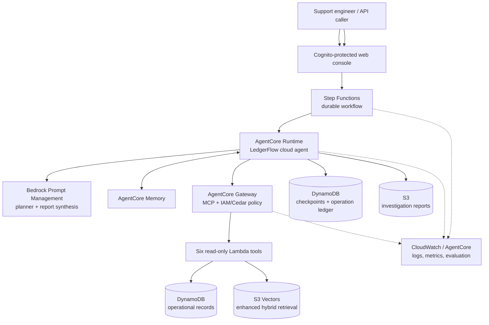

# LedgerFlow Agent Notes

## Repository purpose

LedgerFlow is a deployable, read-only incident-response agent. The supported
runtime is an AWS AgentCore deployment that investigates the synthetic
`ACME-482` duplicate-invoice incident and tenant-scoped timeout,
payment-failure, configuration-error, and duplicate-invoice scenarios.

The repository also contains the deployment-time fixture generator used by
`cloudformation/ingest.py`. It is not a second application runtime.

## Architecture



## Non-negotiable boundaries

- Keep investigation tools read-only. The POC must reject financial mutations.
- Enforce tenant authorization in Gateway policy and backend tool code; do not
  rely on model instructions to select or protect tenants.
- Emit typed evidence claims under `ledgerflow.evidence.v2`; every finding and
  report citation must reference an ID from the authorized evidence packet.
- Persist workflow checkpoints and operation IDs so interrupted investigations
  can resume without duplicating report publication.
- Treat AgentCore Memory as supporting context. Transient memory failures must
  not hide primary operational evidence.

## Useful commands

```bash
python3 -m pytest
python3 cloudformation/validate.py
python3 cloudformation/deploy.py --environment dev --plan
./deploy-all.sh --help
```

The complete AWS deployment procedure is documented in `DEPLOYMENT.md` and
`README.md`. Changes should remain explicit and use the documented
CloudFormation stack order.
