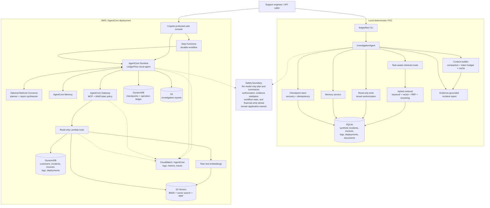

# LedgerFlow Agent Notes

## Repository purpose

LedgerFlow is a proof-of-concept incident-response agent. It investigates the
synthetic `ACME-482` duplicate-invoice incident and a larger set of tenant-scoped
timeout, payment-failure, configuration-error, and duplicate-invoice scenarios.
The local implementation is deterministic so retrieval, authorization, memory,
context management, schema-driven evidence reasoning, and workflow recovery can
be tested without AWS credentials.

The AWS deployment adapts the same orchestration boundary to Amazon Bedrock
AgentCore and related managed services.

## Architecture



## Non-negotiable boundaries

- Keep investigation tools read-only. The POC must reject financial mutations.
- Enforce tenant authorization in application/tool code; do not rely on model
  instructions to select or protect tenants.
- Emit typed evidence claims under `ledgerflow.evidence.v2`; every finding and
  report citation must reference an ID from the authorized evidence packet.
- Preserve invariants during context compaction, especially no financial
  writes, evidence requirements, and approval requirements for remediation.
- Persist workflow checkpoints and operation IDs so interrupted investigations
  can resume without duplicating report publication.
- Treat memory as supporting context. Transient memory failures must not hide
  primary operational evidence.

## Useful commands

```bash
python3 -m ledgerflow.cli seed --reset
python3 -m ledgerflow.cli investigate ACME-482
python3 -m ledgerflow.cli investigate ACME-487
python3 -m pytest
```

The deterministic seed currently contains 21 documents, 112 incidents, 212
customers, 215 invoices, 5,030 application logs, and 42 deployments. The
additional `tenant_acme` cases are defined in `ledgerflow/db.py`.

To exercise recovery:

```bash
python3 -m ledgerflow.cli investigate ACME-482 \
  --db /tmp/ledgerflow-recovery.db \
  --workflow-id demo-recovery \
  --reset \
  --fail-after-step log_lookup

python3 -m ledgerflow.cli investigate ACME-482 \
  --db /tmp/ledgerflow-recovery.db \
  --workflow-id demo-recovery
```

AWS infrastructure is validated and deployed through the scripts in
`cloudformation/`; changes should remain explicit and use the documented
CloudFormation stack order.
