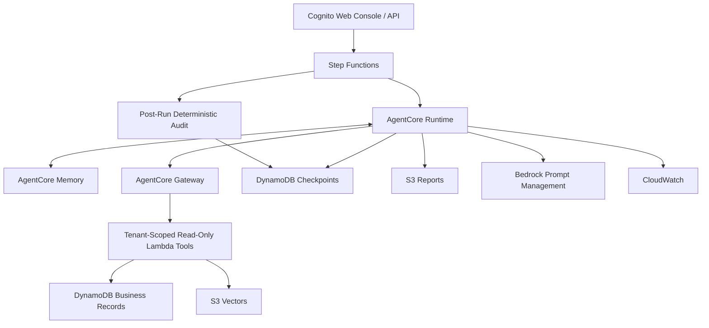

# LedgerFlow Incident Response Agent: Case Study

## Executive Summary

LedgerFlow is a deployable AWS proof of concept for investigating tenant-scoped financial incidents. It investigates duplicate invoices, payment failures, timeouts, and configuration errors, then produces an auditable report from authorized evidence.

The implementation demonstrates a bounded agent architecture:

- Bedrock is used for optional investigation planning, context summarization, and report synthesis.
- AgentCore Runtime, Gateway, and Memory provide the execution, tool boundary, and tenant-isolated memory services.
- Step Functions and DynamoDB provide durable workflow execution and checkpoint recovery.
- S3 Vectors provides hybrid evidence retrieval using Titan embeddings, full-text search, and application reranking.
- Deterministic application code owns authorization, retrieval policy, evidence validation, workflow state, and report publication.
- The system exposes read-only investigation tools. It does not perform financial writes.

This document describes the implementation in the repository as it exists today. Deployment procedures remain in [`DEPLOYMENT.md`](DEPLOYMENT.md).

## Problem and Canonical Incident

LedgerFlow processes subscription payments for business customers. An operator needs to investigate a report such as:

> Investigate why customer ACME-482 received duplicate invoices following the November deployment. Identify the root cause, provide supporting evidence, and recommend corrective actions. Do not perform financial modifications without approval.

The synthetic `ACME-482` case represents a duplicate-invoice incident after a payment timeout:

1. Earlier retry handling reused the original idempotency key.
2. Deployment `3.8.2` regenerated the key after a timeout.
3. The retry was treated as a new payment operation.
4. Two invoices were issued for the same renewal.
5. The report connects the incident, invoice records, application logs, deployment history, and retry runbook to this conclusion.

The fixture corpus also includes payment failures, unresolved and reconciled timeouts, configuration errors, additional duplicate-invoice cases, and a large context-compaction case (`ACME-496` / `INC-1059`).

## Implemented Architecture



The runtime is an HTTP container invoked by Step Functions. The web application starts investigations and reads workflow events and reports through an API Gateway and Lambda backend.

## Investigation Workflow

A request follows this completed path:

1. The console submits a customer, tenant, request, and workflow ID to Step Functions.
2. The Runtime creates or resumes a durable workflow and acquires a DynamoDB lease.
3. Bedrock optionally produces a small validated investigation plan. If model reasoning is disabled or unavailable, the runtime uses a deterministic fallback plan.
4. Application code selects a fixed retrieval policy for the task type. The model cannot expand the policy's source scope or limits.
5. The Runtime invokes read-only Gateway tools for the incident, invoices, application logs, deployments, vector evidence, and—when permitted—verified memory.
6. Evidence is normalized into a typed report with facts, relationships, hypotheses, source IDs, claims, a timeline, findings, recommended actions, and unresolved questions.
7. The deterministic context compactor creates a bounded context packet. It preserves tenant identity, workflow state, safety invariants, required evidence, and citable source IDs. A Bedrock summarizer may add semantic context without replacing the deterministic packet.
8. Bedrock may synthesize the narrative report. Model output is constrained to the report contract and is checked against the authorized evidence set. The deterministic report remains the fallback.
9. A pre-publication audit verifies the report identity, schema, task policy, source citations, tenant scope, memory boundary, and read-only tool usage.
10. The report is recorded idempotently, written to S3, added to tenant-scoped AgentCore Memory, and the workflow is marked complete.
11. Step Functions invokes an independent post-run audit over the checkpoint and event history.

## Retrieval and Evidence

The deployed retrieval path uses an S3 Vectors enhanced index. Evidence is embedded with the configured Titan embedding model, searched with vector and full-text signals, filtered by tenant metadata, and application-reranked before it enters the report context.

The implemented task policies are:

| Policy | Sources and behavior |
| --- | --- |
| `investigation-v1` | Hybrid retrieval with invoices, logs, deployments, verified memory, and vector evidence; top eight vector results and up to 500 logs |
| `explanation-v1` | Semantic retrieval focused on runbooks and deployments; excludes invoices, logs, and memory |
| `verification-v1` | Authoritative retrieval using runbooks plus current invoices, logs, and deployments; excludes memory |

The Gateway exposes six read-only tools:

- Search incidents.
- Read customer invoices.
- Read application logs.
- Read deployments.
- Read current invoice state.
- Search tenant-scoped evidence in S3 Vectors.

Every tool request carries a tenant ID. The Lambda handlers verify customer ownership and tenant scope before returning data. Report evidence IDs and claim citations must come from the authorized evidence packet.

## Context and Model Boundaries

The default context budget is 8,000 estimated tokens. Compaction keeps raw workflow evidence outside the model's working context while retaining a bounded, structured representation with:

- read-only and no-financial-write invariants;
- the customer, tenant, workflow, and task policy;
- typed facts, relationships, and hypotheses;
- required and citable evidence IDs;
- bounded evidence previews and memory records;
- omitted-record counts and a deterministic context digest.

The model is responsible for planning and narrative synthesis. It does not own permissions, evidence scope, workflow state, or publication. Prompt definitions for planning, compaction, and synthesis are managed through Amazon Bedrock Prompt Management. Administrators can edit drafts, create immutable prompt versions, and select the active runtime version from the console.

## Durable Execution and Recovery

Each investigation stores its state in DynamoDB under a versioned workflow schema. Checkpoints include the current stage, accumulated data, completed stages, tenant and customer identity, lease information, failure-injection state, and report data.

The durable stages are:

`started` → `planning` → `incident_lookup` → `invoice_lookup` → `log_lookup` → `deployment_lookup` → `retrieval` → `memory_lookup` → `context_compaction` → `report_synthesis` → `pre_publish_audit` → `completed`

The Runtime uses leases to prevent concurrent workers from processing the same workflow. On retry, it validates the stored tenant and customer, rehydrates the checkpoint, skips completed stages, and continues at the first incomplete stage. Report publication uses a workflow-derived operation ID so a retry cannot publish the same report twice.

In `dev` and `test`, administrators can use the console's **Dev tools** tab to arm a one-shot failure after a selected checkpoint. The injected failure occurs after the checkpoint is saved. Step Functions retries the Runtime, which resumes from the saved state. This exercises the same checkpoint, lease, idempotency, and event-history behavior used for ordinary recovery. The failure controls are unavailable in production.

## Operator Console

The deployed console is served by Lambda behind API Gateway and Cognito. It provides:

- an Investigation view for starting read-only investigations;
- workflow timelines with tool calls, checkpoints, reasoning summaries, and audit results;
- report views with the executive summary, root cause, timeline, verified findings, recommendations, unresolved questions, and cited evidence;
- an admin-only Prompt library for Bedrock draft and version management;
- an admin-only Dev tools view for deterministic recovery tests;
- admin user and operator access controls through Cognito groups.

Raw prompts and private model reasoning are kept out of the operator-facing event stream. Operators receive bounded lifecycle and reasoning summaries instead.

## Synthetic Dataset

The deployment fixture generator creates:

- 21 evidence documents;
- 113 incidents;
- 213 customers;
- 231 invoices;
- 5,150 application logs;
- 43 deployments.

The `tenant_acme` slice contains the canonical `ACME-482` investigation and additional cases including:

- `ACME-487`: duplicate invoice after a changed retry key;
- `ACME-496`: large evidence set for context-compaction testing;
- payment failures;
- unresolved and reconciled payment timeouts;
- merchant configuration errors.

The data is synthetic and is loaded during deployment. It is intended for repeatable demonstrations and contract tests, not for production financial operations.

## AWS Deployment

Infrastructure is defined as eight independent CloudFormation stacks deployed with AWS SAM:

| Stack | Responsibility |
| --- | --- |
| `00-security` | KMS keys, IAM roles, artifact storage, and security policies |
| `01-storage` | DynamoDB tables and S3 storage |
| `02-s3-vectors` | S3 Vectors bucket, index, and enhanced-index setup |
| `03-tools` | Tenant-scoped Lambda tools |
| `04-agentcore` | AgentCore Runtime, Gateway, Memory, and Bedrock prompts |
| `05-workflow` | Step Functions, workflow audit Lambda, and optional online evaluation |
| `06-observability` | CloudWatch logs, dashboard, metrics, and alarms |
| `07-web-app` | Cognito, API Gateway, web application Lambda, and console access |

`deploy-all.sh` builds the Runtime container, deploys the stacks in dependency order, ingests the synthetic data, and prints the Cognito-protected console URL. Deployment planning and contract validation can be run without creating AWS resources.

## Verification

The repository includes runtime, retrieval, context-compaction, recovery, audit, web-console, SAM, and CloudFormation contract tests.

The main verification commands are:

```bash
python3 -m pytest
python3 cloudformation/validate.py
bash -n deploy-all.sh
node --check frontend/app.js
```

## Repository Mapping

| Path | Implemented responsibility |
| --- | --- |
| `ledgerflow/` | Runtime workflow, planning, retrieval policy, context compaction, evidence analysis, report synthesis, memory, and audit logic |
| `cloudformation/` | Eight-stack infrastructure, deployment orchestration, validation, and fixture ingestion |
| `lambda/` | Gateway tools, web API, workflow audit, and admin bootstrap |
| `frontend/` | Investigation, prompt-management, and recovery-testing console |
| `tests/` | Unit, adapter, recovery, retrieval, audit, web, SAM, and infrastructure contract tests |
| `deploy-all.sh` | End-to-end container build, deployment, and fixture-loading entry point |

## Current Scope and Limits

This implementation is a deployable proof of concept, not a claim of production readiness. The completed scope intentionally excludes:

- refunds, cancellations, charges, credits, invoice changes, or other financial-write tools;
- unrestricted model-directed tool access;
- a generalized multi-agent system;
- multi-region deployment or a production availability guarantee;
- performance, cost, or accuracy claims beyond the included tests and deployment checks.

The design goal is to keep model reasoning useful while making authorization, evidence, and execution state independently verifiable.
