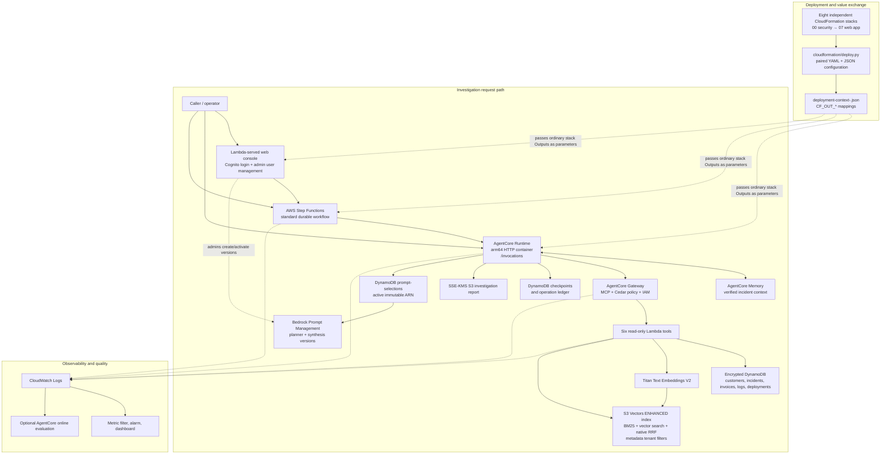

# LedgerFlow Incident Response Agent

This repository is the first runnable vertical slice of the capstone in
`CASE_STUDY.md`. It is deliberately dependency-light: the default runtime uses
Python 3.12, SQLite, and deterministic local retrieval, so the safety and
reliability behaviors can be tested without credentials or network services.

The POC investigates the synthetic `ACME-482` duplicate-invoice incident as its
canonical walkthrough and includes additional tenant-scoped scenarios for
timeouts, payment failures, configuration errors, and duplicate invoices. It
demonstrates:

- read-only investigation tools;
- keyword + deterministic vector retrieval, reciprocal-rank fusion, and reranking;
- schema-driven evidence normalization with typed facts, relationships, and hypotheses;
- evidence claims that are traceable to authorized source IDs;
- tenant-aware authorization filtering;
- task-aware retrieval policies;
- memory deduplication, supersession, provenance, and expiration;
- invariant-preserving context compaction and token budgeting;
- stable-prefix cache accounting; and
- durable checkpoints with resumable workflow state.

The AWS Runtime stores its planner and report-synthesis instructions in
Amazon Bedrock Prompt Management. Each investigation resolves an immutable
prompt-version ARN at runtime. Administrators can view and edit native Bedrock
drafts, create new prompts, create immutable versions, and choose the active
runtime version from the console's Prompt library tab. Operators can inspect
safe reasoning summaries and execution results, but cannot read or change
prompt bodies.

The deterministic seed contains 21 evidence documents, 112 incidents, 212
customers, 215 invoices, 5,030 application logs, and 42 deployments. The
`tenant_acme` slice includes the original `ACME-482` and `ACME-483` records plus
12 additional cases, `ACME-484` through `ACME-495`.

The local agent remains deterministic for regression testing. The deployed AWS
Runtime uses a bounded Bedrock Converse planner and report synthesizer with
`amazon.nova-micro-v1:0`; the model can refine queries and choose which
read-only evidence categories to collect, while Gateway, tenant authorization,
checkpoints, and evidence validation remain application-owned. The model cannot
execute financial writes or cite IDs outside the authorized evidence packet. The
AWS path in this repository uses AgentCore Runtime/Gateway/Memory, DynamoDB,
S3, S3 Vectors, Lambda, Step Functions, Cognito, API Gateway, and CloudWatch
through independent CloudFormation stacks.

## Quick start

Install the local development extras:

```bash
python3 -m pip install -e '.[dev]'
```

The local agent is deterministic and does not require AWS credentials. Run it
from the repository root:

```bash
python3 -m ledgerflow.cli seed --reset
python3 -m ledgerflow.cli investigate ACME-482
python3 -m ledgerflow.cli investigate ACME-487
python3 -m pytest
```

The default database is `.ledgerflow/ledgerflow.db`. To keep the workspace
clean, use a temporary path instead:

```bash
python3 -m ledgerflow.cli demo --db /tmp/ledgerflow-demo.db
```

To demonstrate recovery from an interrupted investigation:

```bash
python3 -m ledgerflow.cli investigate ACME-482 \
  --db /tmp/ledgerflow-recovery.db \
  --workflow-id demo-recovery \
  --reset \
  --fail-after-step log_lookup

python3 -m ledgerflow.cli investigate ACME-482 \
  --db /tmp/ledgerflow-recovery.db \
  --workflow-id demo-recovery
```

The first command intentionally exits with a simulated crash after the log
lookup checkpoint. The second hydrates the checkpoint and completes the report.

Useful expanded scenarios include:

| Customer | Incident | Scenario |
|---|---|---|
| `ACME-484` | `INC-1047` | unresolved payment timeout |
| `ACME-485` | `INC-1048` | merchant configuration error |
| `ACME-487` | `INC-1050` | duplicate invoice after a changed retry key |
| `ACME-488` | `INC-1051` | timeout reconciled with a successful provider outcome |
| `ACME-490` | `INC-1053` | provider payment failure |
| `ACME-495` | `INC-1058` | timeout followed by a safe retry |

The remaining expanded cases are in `ledgerflow/db.py` and follow the same
schema-driven evidence path.

## Layout

```text
ledgerflow/
  agent.py          end-to-end investigation orchestrator
  cli.py            local command-line entry point
  context.py        invariants, compaction, token budgets, cache accounting
  db.py             SQLite schema and deterministic synthetic dataset
  memory.py         memory lifecycle service
  models.py         typed domain objects and report schemas
  evidence_reasoning.py  source normalization and typed evidence claims
  policies.py       task classifier and retrieval policy router
  retrieval.py      keyword/vector/RRF/reranking pipeline
  prompting.py      active native Bedrock prompt-version resolver
  state.py          checkpoints, leases, and operation idempotency
  tools.py          read-only data and authorization tools
  cloud_agent.py    AWS Runtime handler using Gateway, Memory, DynamoDB, and S3
  gateway.py        SigV4 MCP client for AgentCore Gateway
  reasoning.py      optional Bedrock Converse synthesis with citation checks
cloudformation/
  stacks/            matching YAML templates and JSON parameter mappings
  scripts/           deployment configuration and stack-validation helpers
  deploy.py          explicit plan/change-set/execute orchestrator
  validate.py        no-AWS deployment-contract validator
  ingest.py          fixture-to-DynamoDB/S3/S3-Vectors loader
  package_artifacts.py  Lambda artifact builder/uploader
  package_web.py      Lambda-served console artifact builder
lambda/
  tool_handler.py    tenant-scoped read-only Gateway targets
  web_app.py         Cognito-protected console and investigation API
frontend/            Lambda-served control-room UI
Dockerfile           AgentCore Runtime container boundary
deploy-all.sh        one-command build, artifact, ingestion, and deployment entry point
LICENSE              MIT license
tests/              regression tests for the seven concepts
```

## AWS deployment path

AWS operations are never implicit. Validate and preview without creating
resources:

```bash
python3 cloudformation/validate.py
python3 cloudformation/deploy.py --environment dev --plan
```

Deploy the independent stacks in order with the procedure in
[`DEPLOYMENT.md`](DEPLOYMENT.md). The JSON file paired with each YAML stack
resolves `${CF_OUT_*}` values from ordinary predecessor-stack Outputs; there
are no nested stacks, exports, imports, Service Catalog products, or
cross-account dependencies.

The deployed console URL is environment-specific. The deployment script prints
the URL after Stack 07 completes; it requires Cognito authentication.

For a complete development deployment, install `boto3` locally and provide
ambient AWS credentials:

```bash
python3 -m pip install --user boto3
export AWS_ACCESS_KEY_ID=...
export AWS_SECRET_ACCESS_KEY=...
export AWS_REGION=us-east-1
./deploy-all.sh --environment dev
```

`AWS_SESSION_TOKEN` is also supported for temporary credentials. The script
does not select or require an AWS profile. It builds the Linux/arm64 Runtime
image, packages the Lambda and web artifacts, loads the deterministic fixture
corpus, deploys all eight stacks, and prints the authenticated console URL.

## Architecture



## Architecture boundary

The model is not authoritative for permissions, memory, workflow state, or
evidence identity. The schema-driven evidence layer derives the report's typed
claims from the collected records, and model synthesis may only preserve
claims and citations that belong to the authorized evidence packet.
Those concerns are owned by the authorization layer, memory service, context
builder, evidence analyzer, and checkpoint store. The agent can recommend
remediation, but the POC has no financial-write tool and explicitly rejects
attempts to add one.

## Console and prompt management

The deployed console has two views:

- **Investigation** shows run status, checkpoint timeline hover/focus details,
  safe reasoning summaries, execution results, evidence IDs, and the final
  typed report.
- **Prompt versions** is admin-only. It lists the planner and report-synthesis
  Bedrock Prompt Management resources, shows the active immutable version,
  creates new immutable versions from the native Bedrock draft, and lets an
  administrator choose the active runtime version.

Prompt bodies are intentionally not copied into the application repository or
stored in the application database. Bedrock owns the editable draft and
immutable versions; the application stores only the selected version ARN and
audit metadata. Edit or create prompts in the Prompt library view, use **Open
Bedrock** when you need the native AWS console, then refresh the view and
activate the immutable version used by the runtime.

## AWS steps that require an account

The complete development deployment can be run from the repository root with:

```bash
BOOTSTRAP_ADMIN_EMAIL=admin@example.com ./deploy-all.sh --environment dev
```

The script runs tests and contract validation, creates the ECR/artifact
foundation, builds and pushes the digest-pinned Runtime image, packages the
Lambda and web artifacts, ingests the fixture corpus, and deploys all eight
independent stacks. Install the one local deployment dependency first if
needed:

```bash
python3 -m pip install --user boto3
```

The deployment uses the standard ambient AWS environment variables, including
`AWS_ACCESS_KEY_ID`, `AWS_SECRET_ACCESS_KEY`, optional `AWS_SESSION_TOKEN`, and
`AWS_REGION`; no AWS profile is selected by the script.

Useful options are `--environment`, `--region`, `--vector-dimension`, and
`--release-id`. Controlled follow-up deployments can use `--skip-ingest`,
`--skip-tests`, or `--skip-validation`. Run `./deploy-all.sh --help` for the
complete list.

General-purpose S3 buckets use AWS account-regional namespaces rather than
CloudFormation-generated global names. Their prefixes are environment-scoped,
and AWS appends the account/Region suffix automatically. The S3 Vectors bucket
uses an environment-scoped name that is unique within the account and Region.

Use the detailed reviewable procedure in [`DEPLOYMENT.md`](DEPLOYMENT.md) when
change sets must be inspected before execution.

1. Supply `BOOTSTRAP_ADMIN_EMAIL` on the first run if a Cognito administrator
   should be bootstrapped.
2. Confirm the printed `Web console` URL and sign in through Cognito.
3. Run the AWS ACME-482 baseline smoke test, an expanded-case smoke test such as
   ACME-487, and the policy regression suite before enabling Gateway enforcement.
4. Model planning and report synthesis are enabled in the deployed dev stack;
   change `MODEL_ID` only after verifying model access and report quality.
5. Add production tracing, cost telemetry, and a measured reranker.

## Verification

The repository's local checks are:

```bash
python3 -m pytest
python3 cloudformation/validate.py
bash -n deploy-all.sh
node --check frontend/app.js
```

The current fixture suite covers 21 regression tests, and the deployment
validator checks all eight independent CloudFormation stack contracts.

## License

LedgerFlow is released under the [MIT License](LICENSE).
