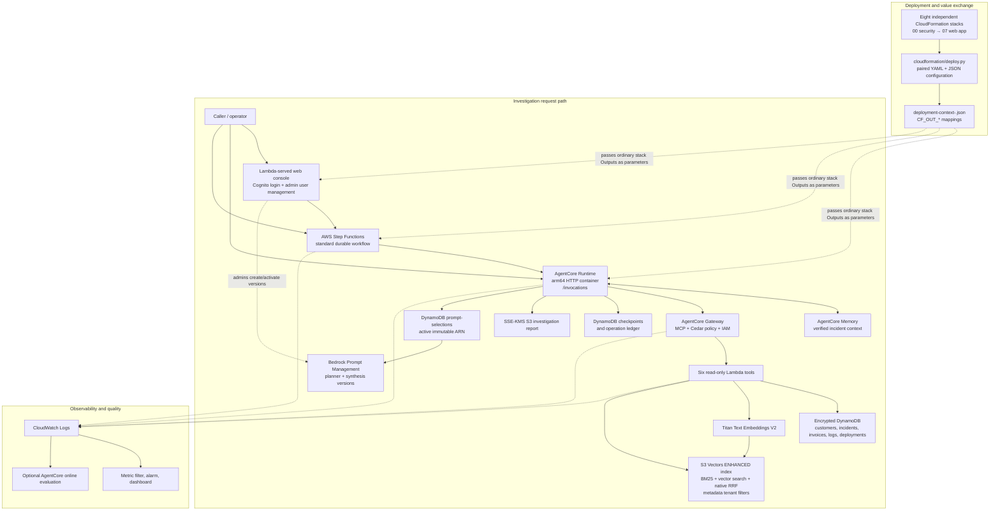

# LedgerFlow Incident Response Agent

This repository is a deployable vertical slice of the capstone in
`CASE_STUDY.md`. The AWS path provisions the AgentCore Runtime, Gateway, Memory,
and supporting services through eight independent CloudFormation stacks and
can be launched with `deploy-all.sh`.

The POC investigates the synthetic `ACME-482` duplicate-invoice incident as its
canonical walkthrough and includes additional tenant-scoped scenarios for
timeouts, payment failures, configuration errors, and duplicate invoices. It
demonstrates:

- read-only AgentCore Gateway tools with tenant authorization;
- S3 Vectors enhanced hybrid retrieval with Titan embeddings and reciprocal-rank fusion;
- schema-driven evidence normalization with typed facts, relationships, and hypotheses;
- evidence claims that are traceable to authorized source IDs;
- AgentCore Memory with tenant namespaces and expiration;
- versioned DynamoDB checkpoints, workflow leases, and idempotent report publication;
- Step Functions durable workflow execution; and
- operator-visible reasoning summaries, execution logs, and typed reports.

The AWS Runtime stores its planner and report-synthesis instructions in
Amazon Bedrock Prompt Management. Each investigation resolves an immutable
prompt-version ARN at runtime. Administrators can view and edit native Bedrock
drafts, create new prompts, create immutable versions, and choose the active
runtime version from the console's Prompt library tab. Operators can inspect
safe reasoning summaries and execution results, but cannot read or change
prompt bodies.

The deterministic deployment fixture corpus contains 21 evidence documents, 112
incidents, 212 customers, 215 invoices, 5,030 application logs, and 42
deployments. The `tenant_acme` slice includes the original `ACME-482` and
`ACME-483` records plus 12 additional cases, `ACME-484` through `ACME-495`.

The deployed AWS Runtime uses a bounded Bedrock Converse planner and report
synthesizer with `amazon.nova-micro-v1:0`; the model can refine queries and
choose which read-only evidence categories to collect, while Gateway, tenant
authorization, checkpoints, and evidence validation remain application-owned.
The model cannot execute financial writes or cite IDs outside the authorized
evidence packet. The AWS path in this repository uses AgentCore
Runtime/Gateway/Memory, DynamoDB, S3, S3 Vectors, Lambda, Step Functions,
Cognito, API Gateway, and CloudWatch through independent CloudFormation stacks.

## Deployment prerequisites

The repository is deployed from a host with:

- Python 3.12 or newer;
- the AWS CLI;
- Docker with Buildx and Linux/arm64 build support; and
- local `boto3` for the deployment scripts.

The deployment scripts use ambient AWS environment variables. The repository
does not select an AWS profile. Local commands are limited to deployment
planning, contract validation, packaging, and tests; the investigation itself
runs in AgentCore Runtime.

The deployment fixture corpus includes these representative scenarios:

| Customer   | Incident   | Scenario                                              |
| ---------- | ---------- | ----------------------------------------------------- |
| `ACME-484` | `INC-1047` | unresolved payment timeout                            |
| `ACME-485` | `INC-1048` | merchant configuration error                          |
| `ACME-487` | `INC-1050` | duplicate invoice after a changed retry key           |
| `ACME-488` | `INC-1051` | timeout reconciled with a successful provider outcome |
| `ACME-490` | `INC-1053` | provider payment failure                              |
| `ACME-495` | `INC-1058` | timeout followed by a safe retry                      |

The remaining cases are generated by `ledgerflow/db.py` for
`cloudformation/ingest.py`; the fixture store is an implementation detail of
deployment, not an application runtime.

## Layout

```text
ledgerflow/
  cloud_agent.py       AWS Runtime handler using Gateway, Memory, DynamoDB, and S3
  db.py                deployment-only deterministic fixture generator
  evidence_reasoning.py  source normalization and typed evidence claims
  gateway.py            SigV4 MCP client for AgentCore Gateway
  models.py             shared report contract
  planner.py            bounded Bedrock investigation planner
  prompting.py          active native Bedrock prompt-version resolver
  reasoning.py          Bedrock report synthesis with citation checks
  runtime_entry.py      AgentCore Runtime entrypoint
  runtime_server.py     HTTP server for Runtime invocations
cloudformation/
  stacks/            matching YAML templates and JSON parameter mappings
  scripts/           deployment configuration and stack-validation helpers
  deploy.py          explicit plan/change-set/execute orchestrator
  validate.py        no-AWS deployment-contract validator
  ingest.py          fixture-to-DynamoDB/S3/S3-Vectors loader
  package_artifacts.py  Lambda artifact builder/uploader
  package_web.py      Lambda-served console artifact builder
lambda/
  tool_handler.py    tenant-scoped read-only Gateway targets
  web_app.py         Cognito-protected console and investigation API
frontend/            Lambda-served control-room UI
Dockerfile           AgentCore Runtime container boundary
deploy-all.sh        one-command build, artifact, ingestion, and deployment entry point
LICENSE              MIT license
tests/              AWS adapter and CloudFormation contract tests
```

## Deployment path

AWS operations are never implicit. Validate and preview without creating
resources:

```bash
python3 cloudformation/validate.py
python3 cloudformation/deploy.py --environment dev --plan
```

Deploy the independent stacks in order with the procedure in
[`DEPLOYMENT.md`](DEPLOYMENT.md). The JSON file paired with each YAML stack
resolves `${CF_OUT_*}` values from ordinary predecessor-stack Outputs; there
are no nested stacks, exports, imports, Service Catalog products, or
cross-account dependencies.

The deployed console URL is environment-specific. The deployment script prints
the URL after Stack 07 completes; it is protected by Cognito authentication.

For a complete AWS deployment, install `boto3` on the deployment host and
provide ambient AWS credentials:

```bash
python3 -m pip install --user boto3
export AWS_ACCESS_KEY_ID=...
export AWS_SECRET_ACCESS_KEY=...
export AWS_REGION=us-east-1
./deploy-all.sh --environment dev
```

`AWS_SESSION_TOKEN` is also supported for temporary credentials. The script
does not select or require an AWS profile. It builds the Linux/arm64 Runtime
image, packages the Lambda and web artifacts, loads the deterministic fixture
corpus, deploys all eight stacks, and prints the Cognito-protected console URL.

## Deterministic recovery test

Failure injection is disabled by default. To exercise checkpoint recovery,
deploy Stack 04 with `FailureInjectionEnabled=ENABLED`:

```bash
python3 cloudformation/deploy.py --environment dev --stack 04-agentcore --execute \
  --set FailureInjectionEnabled=ENABLED
```

Then start a Step Functions execution with a stable `workflow_id` and
`failure_after_step=log_lookup`:

```json
{
  "workflow_id": "recovery-demo-1",
  "customer_id": "ACME-482",
  "tenant_id": "tenant_acme",
  "request": "Investigate the duplicate invoice.",
  "failure_after_step": "log_lookup"
}
```

The first Runtime attempt writes the `log_lookup` checkpoint and fails
deliberately. The Step Functions retry loads that checkpoint, skips the
completed incident, invoice, and log stages, and continues with deployment
lookup. The failure is one-shot per workflow because the checkpoint records
that the injection was consumed. Set `FailureInjectionEnabled=DISABLED` again
after the test.

## Architecture



## Architecture boundary

The model is not authoritative for permissions, memory, workflow state, or
evidence identity. The schema-driven evidence layer derives the report's typed
claims from the collected records, and model synthesis may only preserve
claims and citations that belong to the authorized evidence packet.
Those concerns are owned by AgentCore Gateway policy, the tenant-scoped Lambda
tools, AgentCore Memory, the DynamoDB checkpoint and operation ledgers, and the
schema-driven evidence analyzer. The agent can recommend remediation, but the
POC has no financial-write tool and explicitly rejects attempts to add one.

## Console and prompt management

The deployed console has two views:

- **Investigation** shows run status, checkpoint timeline hover/focus details,
  safe reasoning summaries, execution results, evidence IDs, and the final
  typed report.
- **Prompt versions** is admin-only. It lists the planner and report-synthesis
  Bedrock Prompt Management resources, shows the active immutable version,
  creates new immutable versions from the native Bedrock draft, and lets an
  administrator choose the active runtime version.

Prompt bodies are intentionally not copied into the application repository or
stored in the application database. Bedrock owns the editable draft and
immutable versions; the application stores only the selected version ARN and
audit metadata. Edit or create prompts in the Prompt library view, use **Open
Bedrock** when you need the native AWS console, then refresh the view and
activate the immutable version used by the runtime.

## AWS steps that require an account

The complete development deployment can be run from the repository root with:

```bash
BOOTSTRAP_ADMIN_EMAIL=admin@example.com ./deploy-all.sh --environment dev
```

The script runs tests and contract validation, creates the ECR/artifact
foundation, builds and pushes the digest-pinned Runtime image, packages the
Lambda and web artifacts, ingests the fixture corpus, and deploys all eight
independent stacks. Install the one deployment-host dependency first if needed:

```bash
python3 -m pip install --user boto3
```

The deployment uses the standard ambient AWS environment variables, including
`AWS_ACCESS_KEY_ID`, `AWS_SECRET_ACCESS_KEY`, optional `AWS_SESSION_TOKEN`, and
`AWS_REGION`; no AWS profile is selected by the script.

Useful options are `--environment`, `--region`, `--vector-dimension`, and
`--release-id`. Controlled follow-up deployments can use `--skip-ingest`,
`--skip-tests`, or `--skip-validation`. Run `./deploy-all.sh --help` for the
complete list.

General-purpose S3 buckets use AWS account-regional namespaces rather than
CloudFormation-generated global names. Their prefixes are environment-scoped,
and AWS appends the account/Region suffix automatically. The S3 Vectors bucket
uses an environment-scoped name that is unique within the account and Region.

Use the detailed reviewable procedure in [`DEPLOYMENT.md`](DEPLOYMENT.md) when
change sets must be inspected before execution.

1. Supply `BOOTSTRAP_ADMIN_EMAIL` on the first run if a Cognito administrator
   should be bootstrapped.
2. Confirm the printed `Web console` URL and sign in through Cognito.
3. Run the AWS ACME-482 baseline smoke test, an expanded-case smoke test such as
   ACME-487, and the policy regression suite before enabling Gateway enforcement.
4. Model planning and report synthesis are enabled in the deployed dev stack;
   change `MODEL_ID` only after verifying model access and report quality.
5. Add production tracing, cost telemetry, and a measured reranker.

## Verification

The repository's pre-deployment checks are:

```bash
python3 -m pytest
python3 cloudformation/validate.py
bash -n deploy-all.sh
node --check frontend/app.js
```

The regression suite covers AWS adapter behavior and all eight independent
CloudFormation stack contracts. The fixture loader defaults to an in-memory
SQLite source while uploading the deterministic corpus to AWS; it is not a
supported application runtime.

## License

LedgerFlow is released under the [MIT License](LICENSE).
