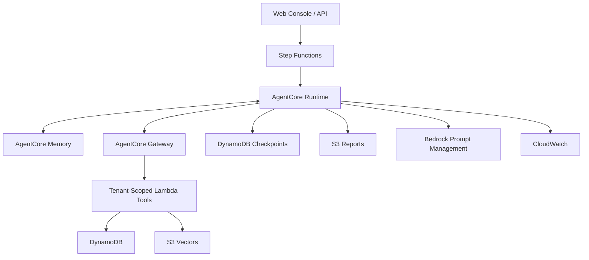

# LedgerFlow Incident Response Agent

An AWS-deployed AI agent for investigating financial incidents using tenant-scoped evidence, durable workflows, and auditable reports.

Built as a deployable proof of concept for [`CASE_STUDY.md`](CASE_STUDY.md), LedgerFlow investigates duplicate invoices, payment failures, timeouts, and configuration errors. The canonical walkthrough uses the synthetic `ACME-482` incident.

## Features

- AgentCore Runtime, Gateway, and Memory for agent execution, authorized read-only tools, and tenant-isolated context.
- Hybrid retrieval using S3 Vectors, Titan embeddings, BM25, and reciprocal-rank fusion.
- Evidence-grounded reasoning with typed claims, source citations, and deterministic validation.
- Durable execution using Step Functions, DynamoDB checkpoints, workflow leases, and idempotent report publication.
- Versioned prompts managed through Amazon Bedrock Prompt Management.
- Operator console with investigation timelines, reasoning summaries, audit results, and reports.
- Recovery testing through admin-only failure injection and checkpoint-based retries.

The model handles investigation planning and report synthesis. Authorization, retrieval boundaries, evidence validation, and workflow state remain deterministic. No financial-write tools are exposed.

## Architecture



Infrastructure is provisioned through eight independent CloudFormation stacks using AWS SAM.

## Deployment

Prerequisites: Python 3.12+, AWS CLI, AWS SAM CLI, Docker with Linux/arm64 Buildx support, and boto3.

Configure AWS credentials and Region using standard environment variables.

Validate and preview the deployment without creating resources:

```bash
python3 cloudformation/validate.py
python3 cloudformation/deploy.py --environment dev --plan
```

Deploy the complete AWS environment:

```bash
python3 -m pip install --user boto3
BOOTSTRAP_ADMIN_EMAIL=admin@example.com ./deploy-all.sh --environment dev
```

The script builds the Runtime container, deploys all eight stacks, loads synthetic investigation data, and prints the Cognito-protected console URL.

See [`DEPLOYMENT.md`](DEPLOYMENT.md) for deployment configuration, stack dependencies, and manual procedures.

## Demo and Recovery Testing

The deployment includes synthetic tenant-scoped incidents covering duplicate invoices, payment failures, timeouts, and configuration errors.

- `ACME-482`: Canonical duplicate-invoice investigation.
- `ACME-487`: Duplicate invoice caused by a changed retry key.
- `ACME-496`: Large evidence set for context-compaction testing.

In dev and test, administrators can use the console’s Dev tools tab to inject a one-shot failure after a checkpoint. Step Functions retries the workflow, completed stages are skipped, and report publication remains idempotent.

## Verification

```bash
python3 -m pytest
python3 cloudformation/validate.py
bash -n deploy-all.sh
node --check frontend/app.js
```

## Repository Structure

| Path | Purpose |
| --- | --- |
| `ledgerflow/` | Agent Runtime, planning, retrieval, evidence reasoning, and report synthesis |
| `cloudformation/` | Infrastructure stacks, deployment orchestration, and fixture ingestion |
| `lambda/` | Gateway tools and web application API |
| `frontend/` | Investigation and administration console |
| `tests/` | Runtime, retrieval, recovery, and infrastructure contract tests |
| `deploy-all.sh` | End-to-end AWS deployment |

## Documentation

- [`CASE_STUDY.md`](CASE_STUDY.md): Business context, requirements, scenarios, and acceptance criteria.
- [`TUTORIAL.md`](TUTORIAL.md): Technology choices, implementation details, and verification guide.
- [`DEPLOYMENT.md`](DEPLOYMENT.md): AWS deployment and operational procedures.

## License

MIT
